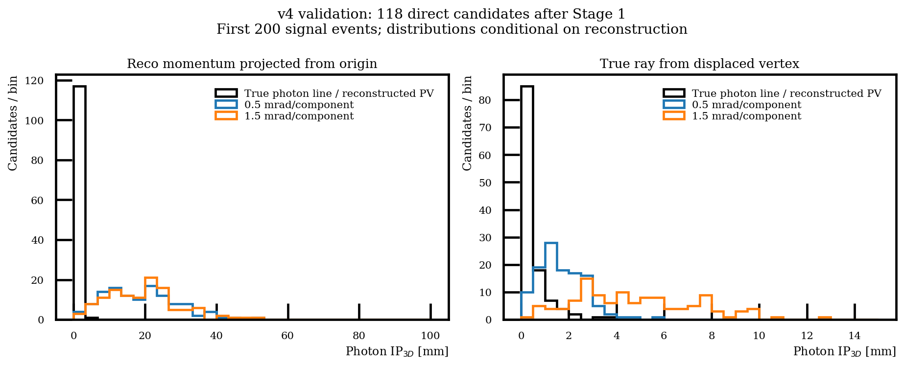

# v4 photon pointing tuple handoff — 2026-10-05

**Question:** can the PI reprocess once, then investigate calorimeter pointing
after Stage 2/BDT without retrieving the original EDM4hep files again?

**Implemented:** an opt-in v4 entry point attaches 28 photon diagnostic vectors
after reconstructed candidate building. It stores true momentum and production
vertex, the true-ray hit on the effective IDEA cylinder/endcaps, the alternative
origin/reconstructed-direction hit, PV and geometry parameters. Existing photon
energy and Cartesian momentum survive Stage 2, alongside Lambda momentum/SV.
All six angular hypotheses (0.5–1.5 mrad in 0.2 mrad steps) are generated offline.
No random smearing enters Stage 1. Each reused photon receives a consistent,
reproducible draw. Inputs for nonmatched photons are explicitly unresolved.

**Comparison:** first 200 events of the existing Physics signal input, with the
same v3 selection and observable configs. Exact commands, hashes, input and
software revisions are in the [manifest](data/stage1_v4_pointing_validation/manifest.json)
and [validation](data/stage1_v4_pointing_validation/validation.json).

| Check | Result |
|---|---:|
| Input events, each run | 200 |
| Candidate-bearing events | 121 |
| Stage 1 candidate rows | 133 |
| Direct truth-matched candidates / wrong combinations | 118 / 15 |
| Original branches identical between v3 and v4 | 474 / 474 |
| New candidate vectors with correct lengths | 28 / 28 |
| Matched photons / valid truth-ray hits | 133 / 133 |
| Stage 2 audit / selected rows retaining fields | 133 / 129 |
| Rows after frozen BDT score ≥ 0.9855620861, retaining fields | 46 |

The BDT count is a handoff check on this small signal pilot, with no additional
Armenteros or veto cut. It is not a new efficiency or optimized selection.
The validator checks identical values of all old branches, geometric closure,
surface membership, downstream retention and random draws under row reversal.
Additional tests cover barrel/endcap/hole/seam/outside rays, invalid directions,
reused photons, unresolved matches and processing a row in a separate batch.
The native Condor worker configuration imports successfully with all 502 output
branches; a complete inclusive campaign has not been launched or validated.

## Results and figure

- [Paired validation and counts](data/stage1_v4_pointing_validation/validation.json).
- [Required Stage 1 branch validation](data/stage1_v4_pointing_validation/branch_validation.json).
- [Frozen Stage 1 audit table](data/stage1_v4_pointing_validation/signal_stage1_audit_v4.parquet).
- [Frozen post-BDT pointing table](data/stage1_v4_pointing_validation/signal_post_bdt_pointing_v4.parquet).
- [Pilot hit-anchor comparison figure](figures/stage1_v4_pointing_validation.png), reproduced using [the howto](../howto/stage1_v4_photon_pointing.md).

The plot uses the 118 direct signal candidates after Stage 1. The nominal scenario uses the hit projected from the origin along reconstructed
photon momentum, then assigns the matched truth direction with angular
smearing. The truth-ray projection from the displaced production point is
shown only as a geometry comparison. Each panel has its own horizontal range
and bin width. These are conditional pilot shapes, not expected yields.

**Assumptions and limitations:** the nominal hit is a geometric projection of
the measured ReconstructedParticle momentum from the origin. It is not a saved
Delphes calorimeter hit. The truth-ray anchor is a geometry comparison, not a
measured hit. Neither is a complete pointing-calorimeter response model.
The inner endcap radius is inferred from |eta|≤3, and the surface is effective.
All matches in this signal pilot are valid; inclusive samples must separately
report unresolved fractions and may not count unresolved photons as rejected.
This check makes no claim yet about Zss suppression or a photon–Lambda vertex
fit. The stored displacement is a distance, not an uncertainty-normalized
significance. Signal acceptance must be reevaluated for any adopted new cut.

**PI handoff:** use the [v4 direct and Condor commands](../howto/stage1_v4_photon_pointing.md)
for signal/PHSP, Zbb, Zcc and Zss in fresh campaigns, catalog each campaign, then
compare pointing-cut efficiencies and mass/angle distributions after the fixed
BDT selection. The PI chooses the detector hypothesis and any reference cut.

## Job and sample preparation update (2026-10-05)

Native FCCAnalyses `--check-only` passed for Zbb (4,398 files), Zcc (5,018)
and Zss (5,015), with 1,200 chunks each, four CPUs per job, accounting group
`group_u_FCC.local_gen`, and job flavour `workday`. The requested string is the
accounting group consumed by `--comp-group`; `--queue` is the separate Condor
flavour setting. No jobs were submitted. The repeatable check and explicit
submission wrapper are documented in the [v4 howto](../howto/stage1_v4_photon_pointing.md).

The merged 100k inventory contains five available modes: signal PHSP and
HELAMP, eta PHSP and HELAMP, and pi0 HELAMP. The configured pi0 PHSP file is
not present at its expected merged path. The direct rerun wrapper lists all
inputs by default, writes fresh `_stage1_v4` ROOT names, and performs a full v4
vector validation after each run.

## Nominal hit-anchor clarification (2026-10-05)

A review of the sketch found that the code offered the requested reco-hit
method, but its command-line default selected the truth-ray hit instead. The
nominal offline procedure is now explicit and set as the default:

1. Project the stored ReconstructedParticle photon momentum from the origin to
the effective surface to define the hit position.
2. Use the matched truth photon momentum as the direction, with the six angular
smearing hypotheses around it.
3. Scale the smeared direction by reconstructed photon energy and calculate
$IP_{3D}$ and $|d_0|$ relative to the reconstructed PV after BDT selection.

The truth vertex and truth-ray hit remain useful for geometry closure and the
comparison panel. The updated offline validation uses the reco projected hit;
its Parquet metadata identifies this anchor. A focused check sets reco and truth
hits to different points and verifies that the nominal output uses the reco
point. Reconstructed and truth momenta are key inputs, while reconstructed
energy, hit position/effective geometry and PV are also required for the present
calculation. No new Stage 1 production was needed for this correction.
