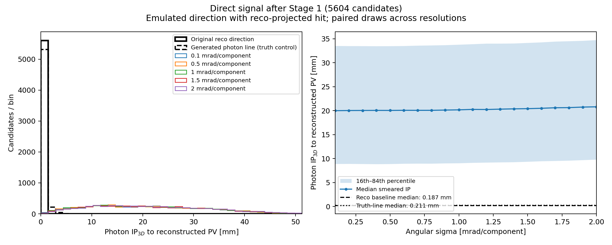
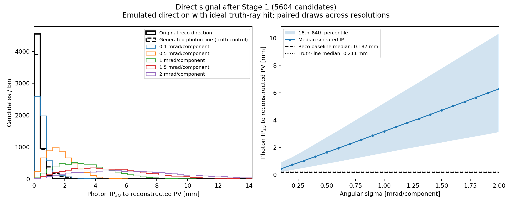

# v4 signal photon-pointing statistical validation — 2026-10-05

## Question

With more signal statistics, does replacing the origin-pointing photon ray by
an emulated calorimeter direction recover the displacement expected from
`Λb → Λγ`, and how does the result depend on the assumed angular resolution?

## Inputs and method

The first 10,000 events of the existing 100k `Lb2LambdaGammaPhysics` IDEA
Stage 0 sample were reconstructed with the v4 tuple extension and unchanged
v3 candidate selection. The source file was copied from its mounted EOS path
to `/tmp` because ROOT could not open the `/eos/lhcb/...` path directly in this
execution environment. The copied file has the previously recorded SHA256
`f483c59cc2fc1274d439c76a2232f272d1c6d54737ddeece6889fb4edb8740dc`.

Exact Stage 1 invocation after sourcing `external/FCCAnalyses/setup.sh`:

```bash
LB_RECO_CONFIG=config/lb_reco_preselection_15mev_45_65_3d.json \
  "$framework_python" external/FCCAnalyses/install/bin/fccanalysis run \
  analysis/studies/lb2lambda_gamma_reco_v4.py \
  --files-list /tmp/rquaglia/lblgamma-pointing/Lb2LambdaGammaPhysics_nev100000_IDEA_edm4hep.root \
  --output signal_physics_first10000_stage1_v4_local.root \
  --ncpus 1 --nevents 10000
```

The output was checked with `validate_stage1_v4_tuple.py`, then flattened with
`flatten_candidates.py --mode gamma --source-id 0`. Candidate building did not
use truth. Full truth matching was applied afterward only to form the direct
signal diagnostic sample. The pointing scan uses the same generated photon
direction and keyed random draws at every resolution from 0.1 to 2.0 mrad in
0.1 mrad steps. Each value is the Gaussian sigma per tangent-plane component.

Reproduce the candidate table and resolution scans with:

```bash
PY='env -u PYTHONPATH -u PYTHONHOME myenv/bin/python'
ROOT=outputs/analysis/studies/pointing_trial_v4_10000/signal_physics_first10000_stage1_v4_local.root
$PY studies/resolutions/validate_stage1_v4_tuple.py --input "$ROOT" \
  --output outputs/analysis/studies/pointing_trial_v4_10000/stage1_validation.json
$PY studies/reconstruction/flatten_candidates.py --input "$ROOT" \
  --output outputs/analysis/studies/pointing_trial_v4_10000/signal_physics_first10000_candidates.parquet \
  --mode gamma --source-id 0 --chunk-events 500
$PY studies/resolutions/scan_stage1_v4_pointing.py \
  --input outputs/analysis/studies/pointing_trial_v4_10000/signal_physics_first10000_candidates.parquet \
  --output-dir docs/data/stage1_v4_pointing_resolution_scan_10000events \
  --namespace stage1_v4_signal_first10000_events --anchor reco \
  --max-mrad 2.0 --step-mrad 0.1 --input-events 10000
$PY studies/resolutions/scan_stage1_v4_pointing.py \
  --input outputs/analysis/studies/pointing_trial_v4_10000/signal_physics_first10000_candidates.parquet \
  --output-dir docs/data/stage1_v4_pointing_truth_anchor_scan_10000events \
  --namespace stage1_v4_signal_first10000_events --anchor truth \
  --max-mrad 2.0 --step-mrad 0.1 --input-events 10000
```

## Counts

| Quantity | Count |
|---|---:|
| Stage 0 input events processed | 10,000 |
| Stage 1 candidate-bearing events | 5,756 |
| Stage 1 candidate rows | 6,139 |
| Direct truth-matched signal candidates | 5,604 |
| Other/wrong candidate combinations | 535 |
| Direct signal candidates with valid pointing inputs | 5,604 |

The wrong combinations remain in the flattened diagnostic input and are
excluded only after candidate building by the truth label for this signal-only
shape comparison. They are not included in the direct signal quantiles below.

## Paired IP comparison

`IP3D` is the distance from the reconstructed PV to the photon line. It is not
the Λb flight length and is not an uncertainty-normalized significance.

| Direction and hit anchor | Angular sigma | Median IP3D [mm] | 16th–84th percentile [mm] |
|---|---:|---:|---:|
| Original reconstructed direction; origin-projected hit | — | 0.187 | 0.050–0.436 |
| Generated photon line from its true production vertex | — | 0.211 | 0.045–0.726 |
| Smeared generated direction; ideal truth-ray hit | 0.1 mrad | 0.434 | 0.204–0.891 |
| Smeared generated direction; ideal truth-ray hit | 1.0 mrad | 3.174 | 1.597–5.239 |
| Smeared generated direction; ideal truth-ray hit | 2.0 mrad | 6.280 | 3.120–10.321 |
| Smeared generated direction; reco-projected hit | 0.1 mrad | 19.981 | 8.855–33.495 |
| Smeared generated direction; reco-projected hit | 1.0 mrad | 20.160 | 9.008–33.754 |
| Smeared generated direction; reco-projected hit | 2.0 mrad | 20.793 | 9.771–34.710 |

The truth-line reference confirms a nonzero photon-line displacement in signal,
although the median distance is small: most of the Λb flight can lie along the
photon line and therefore does not contribute to its impact parameter. With
the PV-to-photon-production displacement at a median **1.60 mm** in 3D
(16th–84th percentile 0.37–4.43 mm), the actual generated decay vertex is
clearly displaced. The smaller 0.211 mm photon-line IP is the perpendicular
component of that displacement. With
the ideal truth-ray hit, increasing angular sigma moves the IP distribution
outward as expected. This is the clean geometry control for the angular
resolution scan.

The reco-projected hit scenario instead starts near 20 mm even at 0.1 mrad and
changes little through 2 mrad. That offset comes from combining a hit
projected using the origin-pointing reconstructed direction with a separate
truth-based direction. It is dominated by this hit-anchor approximation and
must not be interpreted as the expected physical signal IP or as evidence for
a 20 mm signal displacement.

## Interpretation and next step

This larger signal sample supports the expected angular-smearing behavior
when the impact position is idealized at the generated truth-ray hit. It also
shows that the current reco-projected hit proxy is not adequate for isolating
the physical displacement effect: its anchor-direction mismatch dominates the
resolution scan. The truth-ray anchor is a closure benchmark, not a measured
calorimeter cluster position. Neither study is a data-level observable,
selection efficiency, or background-rejection result.

Keep both anchors labelled as separate response scenarios. Before interpreting
the reco-anchor scan physically, specify a cluster-position response and its
correlation with the measured photon direction (including tower granularity).
Then apply the same named response to signal and inclusive Zbb/Zcc/Zss samples;
do not choose a cut from this signal-only study.

## Artifacts and provenance

- [Reco-anchor resolution scan](data/stage1_v4_pointing_resolution_scan_10000events/signal_pointing_resolution_scan.png)
- [Ideal truth-anchor resolution scan](data/stage1_v4_pointing_truth_anchor_scan_10000events/signal_pointing_resolution_scan.png)
- [Reco-anchor scan summary](data/stage1_v4_pointing_resolution_scan_10000events/summary.json)
- [Ideal truth-anchor scan summary](data/stage1_v4_pointing_truth_anchor_scan_10000events/summary.json)
- Stage 1 ROOT: `outputs/analysis/studies/pointing_trial_v4_10000/signal_physics_first10000_stage1_v4_local.root`
- Flattened candidates: `outputs/analysis/studies/pointing_trial_v4_10000/signal_physics_first10000_candidates.parquet`
- Stage 1 validation: `outputs/analysis/studies/pointing_trial_v4_10000/stage1_validation.json`
- Reproduction script: [`scan_stage1_v4_pointing.py`](../studies/resolutions/scan_stage1_v4_pointing.py)
- Repository revision: `ca8c55e8a406889f6d45675dbcb860fe5ec8f232`; FCCAnalyses revision: `0315db1e2941e2886813cb645193e348f3863d5d`.
- Reconstruction config SHA256: `b872906ad0b25f94299c2ba627b0804d558c407134ca01f3e212c638e6cffa18`.
- v4 reconstruction module SHA256: `9657795a0267166dd83cb3464dcffbf4be35591e944567c0660cf777a750c845`.
- v4 pointing header SHA256: `ab84f63cb65d96aa6aa03b831233f731a5c0f7fb71127ecd2983167ad8426635`.
- Stage 1 output SHA256: `cd9709b9bda0f23e195fe8471cc38d384ba92b7bd34263437b12b4b4f7bf92cc`.




